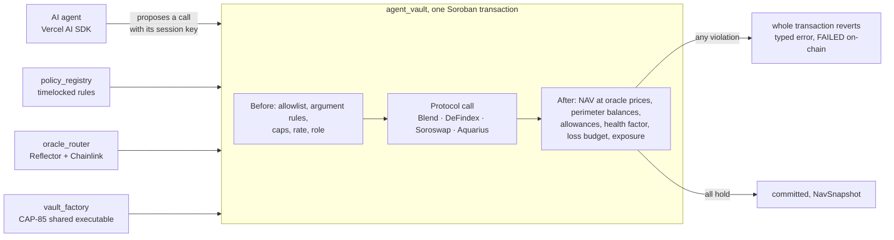

# Tsuna

**Your agents. The chain's rules.** DeFi vaults on Stellar run by AI agents, with every limit enforced on-chain by the vault contract, before and after each call, in the same transaction.

**Live demo:** https://tsuna-fi.vercel.app · **Docs:** https://tsuna-fi.vercel.app/docs · **Network:** Stellar testnet · **HackMeridian 2026**, path Genesis, tracks **Stellar Composed** and **Stellar Unlocked**.

> The agent proposes. The chain decides. A hijacked agent hits a wall, not your funds.

## Demo

Everything below runs on Stellar testnet and can be opened in an explorer. Suggested path for a judge (about 5 minutes):

1. **Sign up with a passkey** at [`/onboarding`](https://tsuna-fi.vercel.app/onboarding): an OpenZeppelin smart account is deployed for you, fees are sponsored by a relayer. No seed phrase, no gas, no jargon.
2. **Take test USDC** from the built-in faucet, then **deposit** into [Agent Prudent](https://tsuna-fi.vercel.app/agents/prudent) for vault shares.
3. **Run the agent**: it reads rates, positions and oracle prices, simulates its calls, and the vault authorizes them on-chain. Every journal line links to its transaction.
4. **Attack it** in the [Attack lab](https://tsuna-fi.vercel.app/agents/prudent/attack): five attacks, five `FAILED` transactions with the vault's typed error.
5. **Crash the market** on [Agent Leverage](https://tsuna-fi.vercel.app/agents/leverage): XLM −30 % through a testnet demo oracle, borrowing refused, vault paused, a risk-off role that can only reduce risk, and a depositor who still withdraws.
6. **Upgrade the fleet** at [`/fleet`](https://tsuna-fi.vercel.app/fleet) (CAP-85), **bridge** USDC from Ethereum Sepolia at [`/bridge`](https://tsuna-fi.vercel.app/bridge) (Circle CCTP), **publish** your own agent at [`/create`](https://tsuna-fi.vercel.app/create).

Receipts from the demo, each checked with RPC `getTransaction`:

| What happened | Error | Status | Transaction |
|---|---|---|---|
| Prompt injection: the model read a poisoned page and tried to send the vault's USDC to the attacker | `CallNotAllowed` | FAILED | [`168a0c43…`](https://stellar.expert/explorer/testnet/tx/168a0c439467bc7d33e7522263fb477da5641a04835f56e1f08f0f80145102a1) |
| Blend withdrawal paid to the attacker | `DestinationNotVault` | FAILED | [`035e4d10…`](https://stellar.expert/explorer/testnet/tx/035e4d1065e045005de75e8b1dfecc6cb11863b1fbd7298b63db2a01b7749072) |
| Allowed DeFindex call that moves the vault's shares out | `NavDropped` | FAILED | [`8381a66e…`](https://stellar.expert/explorer/testnet/tx/8381a66e95630a9c64c486152e2121a4ca425daec4c0ab08afb5ecb6449f20f3) |
| Soroswap route through the attacker's token | `AssetNotAllowed` | FAILED | [`93f85eed…`](https://stellar.expert/explorer/testnet/tx/93f85eede3277e7682fbfa296faaadc8c23979ad90f51770b5572168b124970e) |
| Stolen session key used by the attacker | `DestinationNotVault` | FAILED | [`58cd7076…`](https://stellar.expert/explorer/testnet/tx/58cd7076115893c9e70a7de6b587fc4e48ad7e7571c063ea7e3bec6b4fc54dda) |
| Crash: the yield agent borrows more | `HealthFactorTooLow` | FAILED | [`608e7c11…`](https://stellar.expert/explorer/testnet/tx/608e7c11fa1127a14ab15f1236d809256d4170f3f2044e040f3ea93b2161e74c) |
| Crash: the risk-off role tries to borrow | `RiskIncreased` | FAILED | [`1d7df061…`](https://stellar.expert/explorer/testnet/tx/1d7df061806557b1dfd0e9441efd4b7571064e207c36c061d82619e9c07fbfa9) |
| Crash: the risk-off role repays Blend debt while paused | | SUCCESS | [`0a8172d9…`](https://stellar.expert/explorer/testnet/tx/0a8172d91a077a73c4c1d0cd117289a7c980fc25cb688c414d3e94dafa04e4e1) |
| Crash: a depositor withdraws while paused | | SUCCESS | [`803acc9b…`](https://stellar.expert/explorer/testnet/tx/803acc9b4be41319c704364c8b95eb738b369638fc75eca6eceda91b8cfad122) |
| Fleet upgrade: one `apply_ref` moves every vault to a patched build | | SUCCESS | [`7aea427f…`](https://stellar.expert/explorer/testnet/tx/7aea427f504ce64d8f79f210c1387e52b9f64a86cfea6dc9cbd19efeabb093df) |
| CCTP: USDC burned on Sepolia, minted on Stellar | | SUCCESS | [`389e6c67…`](https://stellar.expert/explorer/testnet/tx/389e6c673771a71444e759c16e161b8aee6d9f795f9642879f52366af47e7459) |
| CCTP: bridged USDC deposited into a vault | | SUCCESS | [`42769b06…`](https://stellar.expert/explorer/testnet/tx/42769b06a3161116a18b01303bbbef852a9eef74e72adc95ae8f112c7d3135f7) |

Only the prompt injection asks the model to choose the call; the other attacks are the calls a compromised runtime or a key thief would build, and the app labels each one with who chose it.

## Why it matters

AI agents now manage real money, and the only thing stopping a fooled agent is usually a prompt asking it to behave. In May 2026 a reply written in Morse code made Grok's Bankr wallet send $150–200k to a stranger, and MetaMask's security report described $204,000 drained from one prompt-injected AI wallet. Anyone who gets a sentence in front of the model can rewrite rules that live in a prompt or on a server.

Tsuna moves those rules into the contract that holds the money:

- **Depositors** get an adaptive DeFi strategy with limits anyone can read on-chain, loosening that waits out a public timelock, and a withdrawal that never waits for the agent, even when the vault is paused.
- **Agent creators** publish a strategy, earn a performance fee above a high-water mark, and build a track record from on-chain `NavSnapshot` events that they cannot fake.
- **Stellar protocols** (Blend, DeFindex, Soroswap, Aquarius) receive deposits routed by agents that cannot misuse them.

## How it works



The agent never holds the funds. Its session key can only ask the vault to make a call; the vault builds every token authorization itself (`authorize_as_current_contract`), so the agent never chooses an approval or a recipient.

## What the chain checks

| When | Check | Error |
|---|---|---|
| Before the call | `(contract, function)` allowlisted, one rule per argument; addresses pinned to the vault; every asset in a swap path or lending request allowed | `CallNotAllowed`, `DestinationNotVault`, `AssetNotAllowed` |
| Before the call | Per-call and daily caps in bps of NAV, calls per hour, per-role quotas | `TxCapExceeded`, `DailyCapExceeded`, `RateLimited` |
| After the call | NAV conserved at oracle prices within the rule's tolerance | `NavDropped` |
| After the call | Token balances kept inside the vault and its protocols; no allowance left behind | `ValueLeftPerimeter`, `AllowanceNotCleared` |
| After the call | Blend health factor ≥ 1.3, 24 h loss budget, per-protocol exposure cap | `HealthFactorTooLow`, `DailyLossExceeded`, `ExposureCapExceeded` |
| Outside the call | Permissionless drawdown breaker; `RiskOff` role allowed during a pause only if risk goes down; protocol code-hash pinning | pause, `RiskIncreased`, `ProtocolChanged` |
| Always | Withdrawals stay open, even paused, even without an oracle price; a leveraged exit repays its own share of debt | |

Rules live in `policy_registry`: tightening applies immediately, loosening waits out a public timelock (10 minutes on testnet, 24 h in production) so depositors can leave first. The full specification is under [Specs](#specs).

## Hackathon tracks

**Stellar Composed**: "combines two or more ecosystem tools or projects into something new".

- **Live projects composed in one vault**: Blend (lending, borrowing, health factor), DeFindex (yield vault), Soroswap (oracle-bounded swaps), Aquarius (LP positions), all valued at oracle prices behind the same rules. Adapters in [`contracts/agent_vault/src/adapters`](contracts/agent_vault/src/adapters).
- **Oracles**: `oracle_router` combines Reflector and Chainlink Data Feeds with freshness, deviation and jump checks ([`contracts/oracle_router`](contracts/oracle_router)).
- **Agents that spend**: the agent pays for market signals over **x402** and **MPP** from an agent wallet, an OpenZeppelin smart account whose limit comes from **OpenZeppelin's policy library** (`spending_limit`, 5 USDC per day) ([`contracts/signal_budget`](contracts/signal_budget), [`web/app/api/signals`](web/app/api/signals)).
- **Smart wallets people want to use**: passkey sign-up and sign-in on OpenZeppelin smart accounts with a WebAuthn verifier, sponsored fees. No seed phrases, no gas, no jargon ([`contracts/passkey_account`](contracts/passkey_account)).
- **Bring users and liquidity to Stellar**: **Circle CCTP V2** from Ethereum Sepolia, then a Soroswap swap and a vault deposit ([`scripts/cctp-demo.ts`](scripts/cctp-demo.ts), [`/bridge`](https://tsuna-fi.vercel.app/bridge)).

**Stellar Unlocked**: "gets something new out of Stellar's core protocol features".

- **Externally managed contract executables (CAP-85)**: every vault runs one executable reference held by `vault_factory`; one timelocked, two-admin `propose_ref` / `apply_ref` upgrades the whole fleet with its state intact ([`contracts/vault_factory`](contracts/vault_factory)).
- **Sparse contract type mappings (CAP-86)**: `PolicyV2` adds optional fields to `PolicyV1`; policies written before the schema change are read without migration ([`contracts/policy_registry`](contracts/policy_registry)).
- **Create trustlines through SACs**: passkey and bridge accounts open their USDC trustlines with the Stellar Asset Contract's `trust()`.
- **`Address::executable()`**: each vault pins the Wasm hash of every protocol it calls and pauses itself if a protocol upgrades (`ProtocolChanged`).

## Built with

| Technology | How Tsuna uses it |
|---|---|
| Soroban, soroban-sdk 28 | Six contracts: `agent_vault`, `oracle_router`, `policy_registry`, `vault_factory`, `signal_budget`, `passkey_account` |
| Blend | Supply, collateral and debt valued by the vault's adapter; health factor checked after every call |
| DeFindex | A USDC vault on the Blend strategy as a second yield position |
| Soroswap | Swaps with an oracle-bounded minimum output; the CCTP leg from Circle USDC |
| Aquarius | XLM/USDC liquidity, valued so that a skewed pool cannot inflate NAV |
| Reflector, Chainlink Data Feeds | Both price sources in `oracle_router` (BTC priced by both) |
| OpenZeppelin Stellar contracts | Smart accounts for passkey users and for the agent's signal budget, with the `spending_limit` policy |
| x402, MPP | Paid signal endpoints the agent buys from its capped budget |
| Circle CCTP V2 | Ethereum Sepolia → Stellar deposits |
| Vercel AI SDK, OpenAI | Agent runtime with Zod-typed tools, at most 6 model steps per run |
| Next.js 16, TanStack Query, Playwright | Web app and end-to-end tests against testnet |

## Verify it yourself

- **Byte-for-byte WASM**: the deployed code is the build of this repository. Rebuild with stellar-cli 28.1.0 and compare with `stellar contract fetch` ([commands and hashes](#verify-the-deployed-contracts)).
- **Tests**: `pnpm contracts:test` runs 121 Rust tests (vault accounting, every refusal, roles, oracle failure modes, timelocks, fleet upgrade); `pnpm test` runs the TypeScript suites of the SDK, the agent runtime and the web app; `pnpm --dir web exec playwright test` replays the demo in a browser against testnet.
- **On-chain**: every refusal in the app and in the table above is a `FAILED` transaction carrying the vault's typed error.

## Deployed contracts (testnet)

| Contract | Address |
|---|---|
| `vault_factory` | [`CBANZEDTXPSMYO2SSV67LVF3LHKT5NKUD4KAA6V5VNISCHYU5XCRWSRL`](https://stellar.expert/explorer/testnet/contract/CBANZEDTXPSMYO2SSV67LVF3LHKT5NKUD4KAA6V5VNISCHYU5XCRWSRL) |
| `policy_registry` | [`CAFCIHI5SO5AC46AYRVPFXSEKS4QNVWHRXD67PJNVQ55TT3NLVL2DFDN`](https://stellar.expert/explorer/testnet/contract/CAFCIHI5SO5AC46AYRVPFXSEKS4QNVWHRXD67PJNVQ55TT3NLVL2DFDN) |
| `oracle_router` (production build) | [`CAU563FCQGGON3Q4GG4Z4UBPGY2542GJNJJE2PHJTMA5STYNSRRGYW6F`](https://stellar.expert/explorer/testnet/contract/CAU563FCQGGON3Q4GG4Z4UBPGY2542GJNJJE2PHJTMA5STYNSRRGYW6F) |
| `oracle_router` (demo build, crash scenario only) | [`CBGBW4I4FS4FDJDNLEXOQD3MRBBLBQRWZJV6JATSRKZOAF2UVCFVRO26`](https://stellar.expert/explorer/testnet/contract/CBGBW4I4FS4FDJDNLEXOQD3MRBBLBQRWZJV6JATSRKZOAF2UVCFVRO26) |
| Vault Prudent (Blend + DeFindex) | [`CCRLI4LNEJQGLHVPX56OEIMQ7FVLRD6MLOAKFJHHWS7VD3JUNKV6Z3NF`](https://stellar.expert/explorer/testnet/contract/CCRLI4LNEJQGLHVPX56OEIMQ7FVLRD6MLOAKFJHHWS7VD3JUNKV6Z3NF) |
| Vault Leverage (Blend + Soroswap) | [`CBAA6ABPK3KCUUD3H6T23UKVNCU5TL6EO5WAXYCRSX3FLO6LB47IKKT3`](https://stellar.expert/explorer/testnet/contract/CBAA6ABPK3KCUUD3H6T23UKVNCU5TL6EO5WAXYCRSX3FLO6LB47IKKT3) |
| Vault Liquidity (Aquarius + Soroswap) | [`CDGY3M3WNZRZ23VPD473KJGE65H52ZSRRX7LOXAYHFYWJUJO4UDEUJOP`](https://stellar.expert/explorer/testnet/contract/CDGY3M3WNZRZ23VPD473KJGE65H52ZSRRX7LOXAYHFYWJUJO4UDEUJOP) |
| Signal budget (OpenZeppelin smart account) | [`CDCFBQKZPACXNWPY362GEJZCBVHQTHMET67QSQ6K4WUMTIFEEZVSKKPL`](https://stellar.expert/explorer/testnet/contract/CDCFBQKZPACXNWPY362GEJZCBVHQTHMET67QSQ6K4WUMTIFEEZVSKKPL) |

Every address the app uses is in [`deployments/`](deployments); if this table and those files disagree, the files win.

## Repository layout

```
contracts/   Soroban workspace: agent_vault, oracle_router, policy_registry, vault_factory, signal_budget, passkey_account
packages/    @tsuna/sdk (contract client, policy presets) and @tsuna/agent (runtime, attacks, keeper, crash scenario)
web/         Next.js app: landing, /agents, vault pages, attack lab, /portfolio, /create, /bridge, /fleet, /docs, API routes
scripts/     Testnet deployment, seeding, CCTP, crash and maintenance scripts (pnpm tsx)
deployments/ Testnet addresses and transaction hashes (public, no secrets)
```

## What Tsuna does not protect against

Tsuna stops the agent from moving value out of the vault. It cannot make Blend, Soroswap or any other protocol unhackable: once funds sit in a protocol, they share its risk. Exposure caps per protocol, the drawdown pause and code-hash pinning bound that loss. The agent can also lose money inside its rules, within the per-call tolerance and the daily loss budget. Tsuna bounds the worst case; it does not promise returns.

Known gaps, each with a planned fix (also listed in the app under Docs → Limits):

- **Testnet only**, test USDC only, no external audit yet. Timelocks are 10 minutes on testnet (24 h in production).
- **Demo keys live on the server**: the creator key used by Create, both factory admins and the oracle admin (Docs → Keys lists each one and who holds it in production). The CCTP demo burns from a server-side test wallet, not from the user's own wallet.
- **The demo price switch is immediate** on the Leverage vault's demo router, because the crash scenario needs it. Prudent, Liquidity and every published agent read the production router, which has no such function.
- **Oracle lag**: deposits and withdrawals price at the latest Reflector update (about every 5 minutes) with no entry or exit fee. Only BTC has a second source; USDC and XLM rely on Reflector.
- **Leveraged exits** sell collateral with up to 3 % slippage, borne by the leaver; near liquidation the exit falls back to what idle USDC repays, so a smaller part is redeemed.
- The protocol watch trusts the first code hash it sees, not the protocols' own dependencies. The app's rate limits are kept per server instance.

## Run locally

Requirements: Node.js ≥ 22.12, pnpm 12.15, Rust with `wasm32v1-none`, and Stellar CLI 28.1.

```sh
pnpm install
cp .env.example .env.local
ln -s ../.env.local web/.env.local
pnpm dev
```

Keep the existing environment file and symlink if they are already configured. Use only dedicated Stellar testnet burners for the variables in `.env.example`; never fund them with real assets.

Open `/agents`, create a passkey, then get test USDC before choosing a vault. The getting-started checklist follows the account's actual USDC balance and vault shares. An empty wallet links back to test funding; a vault's Withdraw tab stays available while paused. The attack lab submits real transactions, so inspect the failed receipt rather than treating a successful HTTP response as proof of a block.

`pnpm --dir web exec playwright test ux.spec.ts` checks one primary action, onboarding guidance and mobile overflow across the demo screens. It also creates a real passkey account on testnet to check the empty-wallet path; it does not draw from the faucet or run attacks.

```sh
pnpm typecheck
pnpm lint
pnpm test
pnpm build
pnpm contracts:build
pnpm contracts:test
```

## Roadmap

- External audit of `agent_vault` and `oracle_router`, then mainnet with real Blend and DeFindex strategies.
- More protocols (XOXNO, DeFindex RWA strategies), a public SDK for third-party agent creators.
- Zero-knowledge proofs so a creator can keep a strategy private while proving it stayed within its rules.

# Specs

The sections below document every contract interface, limit, error code and script.

## Browser verification

```sh
pnpm --dir web exec playwright test
BASE_URL=https://tsuna-fi.vercel.app pnpm --dir web exec playwright test --grep @smoke
```

The local suite covers the eleven demo stages with numbered `test.step` entries, including real deposits, model-driven execution, five failed attack receipts, session revocation, the crash and risk-off repayment, a timed fleet upgrade, CCTP and publication. It runs serially against Stellar testnet, not a local chain. Chromium's virtual authenticator signs real passkey account authorizations; no production test-signing endpoint is required.

Mutating scenarios need the dedicated burners in `.env.example`, a configured model, at least 3,000 test USDC in the faucet, and 1 USDC plus gas on the Sepolia bridge burner. The session test uses the isolated runtime vault, reactivates its dedicated key if an interrupted run left it revoked, signs the creator's prepared transaction with its test key, and restores the key and withdrawn funds in `finally`. The fleet upgrade uses the separate test fleet. Do not run transaction suites alongside another demo using the same keys or oracle.

Playwright starts its local server with a 1,000 USDC faucet allowance, independently of the smaller amount configured for the public demo. Reused servers must use the same allowance. The leaderboard hides rehearsal vaults, but holdings still read every known vault: a deposit remains visible in its vault and portfolio even when that vault is not ranked.

`BASE_URL` selects only the read-only smoke and does not start a local server. It checks each public screen, priced vault data, explorer links, project icons and the production `/design` 404. Browser mutation requests are blocked before leaving the page. Use a separate Playwright `--output` directory when running independent read-only checks concurrently.

## Testnet contract validation

```sh
pnpm tsx scripts/fund-usdc.ts
pnpm tsx scripts/spike.ts
```

`fund-usdc.ts` establishes the admin's USDC trustline and targets a 6,000 USDC-Blend balance by supplying XLM collateral and borrowing from the deployed Blend testnet pool. Collateral is calculated from the pool's oracle prices, reserve weights and existing debt, targeting a health factor of 1.75. If needed, it collects XLM from the configured agent, keeper and Alice burners, leaving 1,000 XLM per donor before transaction fees. An absent admin account is created with Friendbot. Insufficient funding fails explicitly.

Collateral supply and borrowing use separate transactions because their combined resource fee can exceed Stellar's 32-bit inner transaction fee limit. The transaction helper supports a fee bump when resource fees exceed that limit. Deployments go through `deployContract` (`scripts/lib/stellar.ts`), which uploads a WASM only when the network does not already hold that exact code; upload rent on testnet can consume thousands of test XLM, paid by the admin.

`spike.ts` builds with `stellar contract build`, uploads the WASMs, deploys a fresh policy registry (10-minute demo timelock) and a fresh vault, registers the vault's policy (call and argument rules, allowed protocol, default limits), sets the Blend adapter (`set_adapter(Blend, pool)`), and deposits 100 test USDC in exchange for shares. The session key supplies 40 USDC to Blend through `submit_with_allowance`; the vault grants the pool an allowance for exactly that amount, valid for the current ledger only, and checks it is consumed. The script prints the simulated resource cost of that `execute`, checks the resulting supply position, NAV and zero residual allowance, then submits two rejected calls: a direct token transfer and a Blend withdrawal addressed to the attacker.

Rejected calls are submitted despite their failed preflight, using a successful invocation's resource budget, which already covers the vault instance and the registry policy entry the rejected call reads. A rejection counts only when RPC `getTransaction` reports `FAILED` and its vault diagnostics contain the expected contract error code. The script also checks that attacker balances and the vault's Blend positions are unchanged. It then lowers the per-call cap (in force immediately), proposes raising it back (pending, publicly readable) and checks that applying it before the timelock fails with `TimelockActive`. It donates 10 test USDC explicitly to exercise performance fees, pauses the vault, checks that deposits are blocked, and redeems the depositor's shares in two withdrawals that unwind Blend. Only protocol fee shares and rounding dust remain invested; at least 5,000 USDC must remain with the admin at completion.

These scripts are testnet transactions, not a local simulation. They spend test XLM on fees and create real lending positions. The vault is deployed against the router recorded in `deployments/testnet.json`.

```sh
pnpm tsx scripts/check-adapters.ts
```

`check-adapters.ts` deploys a vault with the Blend and DeFindex adapters (DeFindex USDC vault `CBMVK2JK6NTOT2O4HNQAIQFJY232BHKGLIMXDVQVHIIZKDACXDFZDWHN`), deposits 100 USDC and has the session key put 40 USDC in each protocol. The DeFindex deposit is simulated first to check that the session key's signature is the only authorization required: the vault authorizes the DeFindex `transfer` itself. The script then reads `nav()` on-chain and recomputes it from raw protocol reads (idle USDC, Blend `get_positions` × `get_reserve` rates, DeFindex `balance` × `get_asset_amounts_per_shares`, non-base amounts through the oracle router), prints both and fails unless they differ by less than 1 bps. It repeats the comparison after withdrawing half of the depositor's shares and checks that both positions were halved.

## Testnet deployment

```sh
pnpm tsx scripts/deploy.ts   # --fresh redeploys every contract
pnpm tsx scripts/seed.ts
```

`deploy.ts` builds the contracts (plus `oracle_router` with `--features demo`), then deploys the demo-mode oracle router (USDC, XLM from Reflector; wBTC from Reflector and Chainlink), the policy registry and the vault factory (admins `LEASH_ADMIN_SECRET` and `LEASH_KEEPER_SECRET`, both signing), each with a 10-minute timelock, and publishes the `agent_vault` WASM as `vault-v1`. A contract recorded in `deployments/testnet.json` is reused while it exists and runs the local build. When the factory still serves an older `agent_vault`, the script uploads the new build, calls `propose_ref`, waits out the 10-minute timelock and calls `apply_ref`: every vault of the fleet runs the new code with its state intact (CAP-85). A new registry or factory starts an empty fleet. The production router stays recorded as `oracleRouterStrict`, and `signalBudget` is copied from `deployments/pay.testnet.json`.

`seed.ts` moves the Soroswap XLM/USDC-Blend pair to the router's XLM price with one swap and fills it to 3,000 USDC. It creates an Aquarius 0.1 % XLM/USDC-Blend pool at that price, paying the creation fee in AQUA bought on Aquarius, and fills it with 1,500 USDC. It also creates a DeFindex USDC vault on the Blend strategy, with the admin in every role, and invests its first deposit. Then it deploys the three demo vaults through the factory: Prudent (Blend + DeFindex, 300 USDC), Leverage (XLM collateral and USDC debt on Blend, Soroswap, 200 USDC) and Liquidity (Aquarius LP, Soroswap, 200 USDC). For each one it registers the policy, sets the adapters, deposits, runs the first session-key executions and reads back `nav()`, `owner()`, `registry()`, `oracle()` and `health_factor()`. Steps already recorded are skipped. USDC-Blend is borrowed on Blend and XLM comes from Friendbot when the admin runs low.

Each demo vault also gets a `riskoff` [role](#agent-roles) held by `LEASH_RISKOFF_SECRET`, in `RiskOff` mode. Its quota is tighter than the default role's: 50% of NAV per call, 100% per day, 6 calls per hour and a 50 bps daily loss. Its allowlist only unwinds:

- Prudent: the Blend call and DeFindex `withdraw`.
- Leverage: the Blend call; the vault grants the pool the allowance a repayment pulls.
- Liquidity: Aquarius `withdraw`.

Blend requests cannot be filtered by type, so the role keeps the Blend call with vault destinations. The RiskOff outcome checks refuse borrowing and new collateral. A fresh vault registers with the role. A vault registered without it goes through `propose_role`, and the script waits out the 10-minute timelock before `apply_policy`. The role is recorded in `deployments/testnet.json` only once it is in force. The script then has the role repay 0.01 USDC of Leverage's Blend debt through `execute_as`, as a check that the role works.

## Verify the deployed contracts

The WASM on testnet is byte-for-byte the build of this repository. Rebuild it and compare hashes:

```sh
stellar contract build --manifest-path contracts/Cargo.toml   # stellar-cli 28.1.0
shasum -a 256 contracts/target/wasm32v1-none/release/{agent_vault,vault_factory,policy_registry,passkey_account,passkey_webauthn_verifier}.wasm

# What the chain runs: the factory itself, and the executable every vault points to.
stellar contract fetch --network testnet --id CBANZEDTXPSMYO2SSV67LVF3LHKT5NKUD4KAA6V5VNISCHYU5XCRWSRL -o factory.wasm
stellar contract fetch --network testnet --wasm-hash "$(jq -r .vaultRef deployments/testnet.json)" -o vault.wasm
shasum -a 256 factory.wasm vault.wasm
```

| Contract | SHA-256 (local build = on-chain) | Recorded in |
|---|---|---|
| `agent_vault` | `87cfe95d9d49dfe12a13277a958b45185eb937df2dc88326149e411272ed089a` | `deployments/testnet.json` → `vaultRef`, `wasm.agentVault` |
| `vault_factory` | `03850acaf57c195d750e66e9451679e00721367b80b79a0ae5aa20e58154f8ec` | `wasm.vaultFactory` |
| `policy_registry` | `6cb452fccf0a11f63139468ac1944502b7ab944945e373a1248b0a340a4b645d` | `wasm.policyRegistry` |
| `passkey_account` | `f97a3bed00bb91cf3574954e4c5c75e83db3599c7ba75ed7fc7012c1c2eb87a8` | `deployments/passkey.testnet.json` → `accountWasmHash` |
| `passkey_webauthn_verifier` | `c2857bd6479c4c846295e43ef6c2fff49bd3ee392ac3d1b9e0e7682d5097d1f3` | `verifierWasmHash` |

The demo oracle router is built separately with `--features demo` (the price-forcing switch used by the crash scenario); its hash is `wasm.oracleRouterDemo`. A vault's executable can only change through the factory's two-admin, timelocked `propose_ref` / `apply_ref` flow, so the `vaultRef` hash is what every vault runs.

## Vault accounting

`deposit(user, amount)` and `withdraw(user, shares)` require the holder's authorization. Deposits and session-key execution stop when paused; withdrawals do not. Shares are internal, non-transferable claims, exposed by `balance(user)` and `total_shares()`.

Conversions use one virtual base-asset unit and 1,000,000,000 virtual shares: `shares = floor(amount × (total_shares + 1e9) / (NAV + 1))`. The 9-decimal offset makes donation-driven inflation expensive without rounding normal deposits to zero; a deposit that would mint zero shares is rejected. `price_per_share()` reports base-asset units per raw share, scaled by `1e18` (initial value `1e9`). The demo USDC has 7 decimals. Intermediate products use 256-bit arithmetic when needed.

Withdrawals unwind every adapter's position in proportion to the redeemed shares, including the virtual-share denominator (see [Protocol adapters](#protocol-adapters)). Payment is capped at the holder's NAV claim and includes only their proportion of idle assets plus actual unwind proceeds. Protocol rounding and virtual-share dust stay in the vault, rather than being taken from remaining holders. Availability still depends on each protocol's liquidity and its own risk checks.

Performance fees crystallize on deposit, withdrawal and successful execution: 10% of gains above the per-share high-water mark. New shares give 99% of that commission to the creator and 1% to the protocol recipient configured at deployment. No assets leave the vault for crystallization; fee holders redeem shares normally. The mark stores an exact post-fee asset/share ratio, stays unchanged through losses, and does not charge again on recovery to the same price. Deposits are priced after old profits have been charged. Direct donations count as gains; the script's donation is not a claim of earned yield.

Fee-recipient balances are touched on every crystallization, including when the fee is zero. This keeps their Soroban read-write footprint stable when lending interest crosses a fee threshold between simulation and inclusion.

`NavSnapshot` records post-action NAV, price per share and ledger timestamp for deposits, withdrawals and successful executions. `Deposited`, `Withdrawn` and `FeesCrystallized` record amounts and share movements. Unit scenarios cover first and subsequent deposits, donation attacks, authorization, rejected and partial withdrawals, pause exits from Blend, debt repayment, fees, loss recovery, rollback, snapshots and large balances:

```sh
cd contracts
cargo test -p agent-vault
stellar contract build
```

## Session limits

`execute(target, fn, args)` is the only path for the session key. In order, it checks that the session is not revoked, the vault is not paused, the vault's policy is registered (`PolicyMissing` (28) otherwise), `(target, fn)` is allowlisted with one rule per argument, and each argument satisfies its rule. The rules live in the [policy registry](#policy-registry): `calls` maps each pair to a `CallRule { args, max_loss_bps, approve }`. Argument rules are `Any`, `Vault`, `Protocol` (an address in the policy's `protocols`), `Amount`, `BlendRequests` and `Assets` (a `Vec<Address>` such as a swap path, where every element must be in the policy's `assets`, else `AssetNotAllowed` (19)). `Amount` arguments and `BlendRequests` (summed, never netted; amounts in other assets valued at strict oracle prices, and refused with `OracleUnavailable` (27) when the oracle has no price for them) are charged against the policy's `limits`. When an [adapter](#protocol-adapters) handles the call, its own valuation of the committed amounts is charged instead:

| Limit | Default | Error |
| --- | --- | --- |
| Per-call amount, in bps of NAV before the call | 10,000 | `TxCapExceeded` (14) |
| Amount per UTC day, in bps of NAV at each call | 100,000 | `DailyCapExceeded` (15) |
| Calls per clock hour, including zero-amount calls | 60 | `RateLimited` (16) |
| Lowest lending health factor (Blend, XOXNO) after the call, in bps, at oracle prices | 13,000 | `HealthFactorTooLow` (17) |
| NAV lost by executions over a rolling 24 h window (hourly buckets), in bps of NAV | 50 | `DailyLossExceeded` (20) |
| Gross value in one protocol after a call that grows it, in bps of NAV (per-protocol override: `exposure_caps`) | 5,000 | `ExposureCapExceeded` (23) |
| Price-per-share drop from the rolling 24-hour peak | 2,000 | pause via `check_drawdown` |

When a rule has `approve`, the vault itself grants the target an allowance for the amount the call may pull (the `Amount` arguments in the base asset, or the net Blend inflow of each asset), expiring at the current ledger; the session key never chooses an approval. After the call, every post-condition must hold or the whole transaction reverts, including any protocol state, allowance and usage counters it wrote:

- NAV must not fall more than the rule's `max_loss_bps` (e.g. 10 for stable-to-stable, 50 for volatile pairs): `NavDropped` (5).
- Losses are added to the rolling 24 h budget, so repeated calls just under the per-call tolerance cannot drain the vault: `DailyLossExceeded` (20). `daily_loss()` reports the amount used.
- Allowances from the vault to the target and to every `Protocol` argument must be back to zero for every allowed asset: `AllowanceNotCleared` (21).
- Token balances are summed over the perimeter (the vault, the target and the custody contracts listed for it in the policy's `guards`, such as a pool or strategy) and must be conserved per asset within the rule's tolerance: `ValueLeftPerimeter` (22). This check reads balances directly, so a protocol that keeps reporting a position while sending the tokens elsewhere is still caught.
- No protocol's gross position may grow beyond the exposure cap. Calls that shrink a position stay allowed, so interest drift never blocks de-risking: `ExposureCapExceeded` (23).

Other refusals: `CallNotAllowed` (1), `DestinationNotVault` (2), `SpenderNotProtocol` (3), `ArgCountMismatch` (4), `Paused` (6), `SessionRevoked` (18). Successful calls emit `Executed(target, fn, nav_before, nav_after)`.

Tsuna stops the agent from moving value out of the vault; it does not make an allowlisted protocol safe. A compromised protocol can still lose what it holds, which is why exposure per protocol is capped and drawdowns pause the vault.

The owner can pause the vault (`set_paused`), `revoke_session`, or `rotate_session` to a new key. `check_drawdown()` is permissionless: anyone can pause a vault whose price per share has fallen below its 24-hour peak by more than the configured drawdown. Peaks are kept in a segment tree indexed by observation, so a check touches a logarithmic number of storage entries and skips expired history. None of these switches blocks withdrawals.

## Agent roles

A vault can give several session keys their own rules, as Zodiac's Roles Modifier does on EVM, except that Tsuna also checks what each call did. The policy's `roles` map names each role to a `Role { member, mode, calls, quota }`: the member's key, `Normal` or `RiskOff`, an allowlist with the same `CallRule`s as `calls`, and a `Quota { tx_cap_bps, daily_cap_bps, calls_per_hour, daily_loss_bps }` counted apart from every other role (`role_usage(role)`, `role_daily_loss(role)`). Protocols, guards, assets, exposure caps and the health-factor floor stay vault-wide. Role `default` is `execute` itself: the session key with the policy's own `calls` and `limits`.

`execute_as(member, role, target, fn, args)` requires `member`'s signature, then fails with `RoleNotFound` (34) for a role the policy in force does not define and `NotRoleMember` (35) when `member` does not hold it (for `default`, the current session key). The call then runs under the role's rules with the pre- and post-conditions above, and emits `RoleExecuted(role, target, fn, nav_before, nav_after)` (`default` emits `Executed`).

A `Normal` role is blocked while the vault is paused, like `default`. A `RiskOff` role may act while paused, but each call must leave the vault no riskier, compared at the same oracle prices before and after the call: the health factor does not fall, no protocol position grows, idle non-base value grows at most by what positions released (no move out of the base asset), and an asset not held before appears only when a position released it. Together with the NAV, perimeter and allowance checks, any violation fails with `RiskIncreased` (36). A RiskOff role can repay Blend debt or withdraw from a protocol during a crash; it cannot borrow, add collateral, withdraw collateral while in debt, or swap into another asset.

Roles change through the registry: `propose_role(vault, name, role)` adds or widens a role behind the timelock (new member, mode change either way, new or wider call, higher quota: `RoleProposed`, then `RoleApplied` on `apply_policy`) and narrows one immediately (`RoleNarrowed`); `revoke_role(vault, name)` is immediate (`RoleRevoked`, `RoleNotFound` (7) if absent) and cancels any pending proposal. A vault has at most 4 roles of at most 8 calls each, and no role may be named `default`.

## Protocol adapters

The owner attaches an adapter to a protocol with `set_adapter(kind, protocol)`; `adapters()` lists them. The protocol must already be in the policy's `protocols` (`ProtocolNotAllowed` (29)), so adding one goes through the registry's timelock. At most `MAX_POSITIONS` (4) adapters hold positions, because every NAV reads them and an `execute` reads them twice (`TooManyPositions` (31)); Soroswap holds none and does not count. A protocol cannot change kind, and `remove_adapter` is refused while it still holds value or debt (`AdapterInUse` (30)). An allowlisted protocol without an adapter is worth nothing in the NAV, so moving funds into it fails `NavDropped`.

| Kind | Position (in base units) | Authorization built by the vault |
| --- | --- | --- |
| `Blend` | Every reserve with supply, collateral or debt: b-tokens × `b_rate`, d-tokens × `d_rate` (rounded up), other assets at strict oracle prices. Health factor: collateral × `c_factor` ÷ (debt ÷ `l_factor`). | Allowances from `approve` rules, per asset. |
| `DeFindex` | `balance(vault)` × `get_asset_amounts_per_shares`, per asset at oracle prices. | `deposit(amounts, mins, from = vault, invest)`: exactly `transfer(vault, defindex, amount)` per asset. |
| `Aquarius` | LP shares × 2·√(v₀·v₁) / total shares, vᵢ = reserve i at oracle prices (two-token constant-product pools only). This equals the reserves' oracle value when the pool trades at the oracle price and is lower otherwise, so skewing the pool cannot inflate the NAV. | `deposit(vault, amounts, min)`: exactly `transfer(vault, pool, amount)` per token (amounts must match the reserve ratio); `withdraw(vault, shares, mins)`: `burn(vault, shares)` on the LP token. |
| `Soroswap` | None. | `swap_exact_tokens_for_tokens(in, min_out, path, to = vault, deadline)`: exactly `transfer(vault, pair, in)`. The pair must be one of the router's `guards` (`SpenderNotProtocol` (3)), every path asset allowed, and `min_out` at least the oracle quote less the rule's `max_loss_bps` (`SlippageTooLoose` (32)). |
| `Xoxno` | The vault's single lending account (position NFT, recorded from its first `supply` with account 0): collateral at oracle prices, health factor with each market's liquidation threshold. | `supply`/`repay`: exactly `transfer(vault, central pool, amount)` per market, on the vault's own account only; `withdraw`/`borrow` must pay the vault (`DestinationNotVault` (2)). |

Entries are derived from the call's arguments and the vault's own addresses, never supplied by the session key, and granted with `authorize_as_current_contract` immediately before the target call (the host keeps them for that call only). Collateral or positions in an asset the strict oracle cannot price count as zero; a debt in such an asset blocks the call instead.

On `withdraw`, the vault exits `shares / supply` of every position itself: Blend in one `submit_with_allowance` per pool (repayments netted against same-asset releases, temporary approvals cleared), DeFindex `withdraw`, Aquarius `withdraw`, XOXNO `repay` then `withdraw`. When the base asset is owed and idle base cannot cover the holder's share of that debt, a priced exit first withdraws non-base collateral worth the shortfall from Blend and sells it for base on the vault's own Soroswap router, through a pair the policy declares (`min_out` at the exit quote less 3 %; the holder bears the slippage), so the exit does not wait for the agent. Both steps are tried, never required: if Blend refuses the release (a position near liquidation) or the swap misses its minimum, the exit falls back to what idle balances repay instead of reverting. Without a router, a declared pair or prices, debt repayment needs idle balances of the debt asset: when they cannot cover the holder's share, fewer shares are redeemed (the `Withdrawn` event reports how many), and none at all gives `RepaymentUnavailable` (33). With exit prices the whole idle balance may fund that repayment, netted against the holder's claim; paid in kind, only the holder's own share may.

XOXNO's testnet deployment is documented at <https://xoxno.com/docs/stellar-lending/dev/addresses> (controller `CCXRWJ6SIU2WPFEGLFGJVITPL57QAYIMIO6OAM2NBGNDQSSCK2FFV3F3`); it lists XLM and Circle USDC markets, not USDC-Blend.

## Policy registry

`policy_registry` stores each vault's policy: `calls`, `protocols`, `guards` (custody contracts per protocol), `assets` (base asset first, then assets the agent may route through, all counted in NAV and paid out on withdrawal), `limits`, and since v2 `exposure_caps` (per-protocol overrides of `max_exposure_bps`) and `roles` ([agent roles](#agent-roles)). The vault is deployed with the registry's address as its sixth constructor argument and reads its policy from it on every `execute`, `check_drawdown`, `nav` and withdrawal; it keeps no rules of its own.

The vault's owner installs the first policy with `register(vault, policy)`, once and before any deposit (`VaultHasDeposits` (4) otherwise): the registry reads the vault's `owner()`, `asset()` and `total_shares()`, requires the owner's signature, and binds that owner as the vault's creator. Every later change goes through `propose_policy(vault, policy)`, signed by the creator, and is classified field by field against the policy in force:

- **Tightening** (remove a call, protocol, guard or asset; lower a cap, tolerance or rate; raise the minimum health factor; constrain an `Any` argument; drop `approve`) applies immediately (`PolicyTightened`) and cancels any pending proposal, which could otherwise undo it.
- **Loosening** (anything the current policy does not grant) is stored as `pending_policy(vault)` with an `eta` of now plus `policy_timelock()` (`PolicyProposed`), so depositors can see it and leave first. A change that tightens some fields and loosens others is a loosening. `apply_policy(vault)` installs it once the timelock has passed (`PolicyApplied`), else fails with `TimelockActive` (6).

Removing an asset is a tightening, but it never takes value out of NAV: the vault records every asset a policy of it has listed (`deposit`, `withdraw`, `execute` and `check_drawdown` add the current ones) and keeps valuing those dropped since. Otherwise a creator could drop an asset the vault holds, deposit at the lower share price and list the asset again after the timelock. The fix shipped to the whole fleet through `propose_ref` / `apply_ref` (apply transaction `7aea427f504ce64d8f79f210c1387e52b9f64a86cfea6dc9cbd19efeabb093df`), and `check_drawdown` was then called on every vault to record their assets.

The timelock is fixed at deployment: 24 h in production, 10 minutes for the testnet demo. Invalid policies (caps above 100%, a zero rate, a health factor below 1, a different base asset, more than 16 calls, 8 assets or 8 protocols, 4 guards per protocol) fail with `InvalidPolicy` (3).

Policies are versioned through Soroban's tolerant struct decoding (CAP-86, soroban-sdk 28): `PolicyV2` adds `exposure_caps` and `roles` as `Option`s to `PolicyV1`, and a field missing from a stored map reads as `None`, so entries written by earlier code are read without migration.

Removing an asset the vault still holds also removes it from NAV and withdrawals until it is allowed again; creators should unwind a position before dropping its asset.

```sh
cd contracts
cargo test -p policy-registry
```

## Oracle

`oracle_router` turns Reflector and Chainlink Data Feeds into prices in USDC with 7 decimals: the asset's USD price divided by USDC's USD price. The admin configures a feed per asset (`set_feed(asset, Feed { reflector, chainlink })`, with `reflector` a Reflector `Stellar(address)` or `Other(symbol)` asset and `chainlink` an optional feed ID). An asset without a feed has no price (`NoPriceFeed`), which the vault counts as zero.

Admin changes are timelocked once the router is set up. `lock(timelock)` ends the setup phase; from then on `set_config`, `set_feed` and `remove_feed` only record a `pending_change()` with an `eta`, which anyone installs with `apply_change()` once the timelock has passed (`TimelockActive`, 8, before; a new proposal replaces the pending one and restarts its clock; the admin can `cancel_change()`). A vault's router is just as slow to change: the owner's `propose_oracle(router)` waits out the registry's policy timelock before anyone can `apply_oracle()` (`OracleTimelockActive`, 38). Two routers are deployed, both locked at 10 minutes (24 h in production): the demo build `oracleRouter` (`CBGBW4I4FS4FDJDNLEXOQD3MRBBLBQRWZJV6JATSRKZOAF2UVCFVRO26`), read only by the Leverage vault for the crash scenario, and a production build without the demo switch, `oracleRouterStrict` in `deployments/testnet.json`, read by Prudent, Liquidity and every agent published with Create (`scripts/strict-router.ts` moved them through `propose_oracle` / `apply_oracle`). Three test vaults whose owner keys live with their own scripts (the runtime test vault and two SDK test vaults) still read the previous router.

| Source | Call | Format | Default maximum age |
| --- | --- | --- | --- |
| Reflector testnet `CCYOZJCOPG34LLQQ7N24YXBM7LL62R7ONMZ3G6WZAAYPB5OYKOMJRN63` | `lastprice(asset)` (SEP-40), `prices(asset, 2)` | `i128`, 14 decimals, USD base, 300 s resolution | 900 s |
| Chainlink Data Feeds proxy testnet `CBUF6IADAWPWIDWRTHJNINKXHG2UTIQ6TU2F2HRAXWAI7OT3KJPKK6O4` | `latest_round(data_id, 18)` | `I256`, 18 decimals | 90,000 s (rounds update on deviation or heartbeat; observed 3 to 10 hours apart on testnet) |

Testnet Chainlink publishes BTC/USD only (`data_id` `01a0b4d920000332000000000000000000000000000000000000000000000000`, [Chainlink docs](https://docs.chain.link/data-feeds/stellar/using-data-feeds-on-chain)). The deployed router (`oracleRouter` in `deployments/testnet.json`) prices USDC-Blend, XLM (Reflector) and wBTC (Reflector + Chainlink, averaged).

Two regimes:

- `price_strict(asset)` serves deposits, `nav()`, `execute` and `check_drawdown`, and fails closed: every configured source must be fresh (`StalePrice`, 2), two sources must agree within `max_deviation_bps` (default 200, else `SourcesDisagree`, 3), and a move above `max_jump_bps` (default 1,500) against the last accepted price within 15 minutes is refused (`PriceJump`, 4) unless both sources agree on it or the two latest Reflector updates of the asset and of USDC hold the new level. Each accepted price is stored with its ledger time (`last_price(asset)`) in temporary storage kept for about a week.
- `price_for_exit(asset)` serves withdrawals and never fails: the strict price when available; otherwise the last valid price cut by `exit_haircut_bps` (default 500), and never above a price refused as a jump; otherwise `None`.

In the vault, the router's errors become `StalePrice` (24), `SourcesDisagree` (25), `PriceJump` (26), or `OracleUnavailable` (27) when the router cannot be called. While a held asset has no strict price, the agent, deposits and `check_drawdown` are blocked. A withdrawal values held assets at exit prices: the holder's share of them is paid in the base asset while the vault has base liquidity, then in kind at the same price. If any held asset has no exit price, or the base asset has no strict price, the holder receives their pro-rata share of each asset (idle balances and unwound positions) without conversion, and fees wait for the next priced action. `WithdrawnInKind(user, asset, amount)` records each non-base payment.

Demo oracle on testnet only: the `demo` Cargo feature adds admin-only `set_demo(enabled)`, `set_demo_price(asset, price)` (event `DemoPriceSet(asset, price)`) and `clear_demo_price(asset)`. Forced prices bypass sources and the jump breaker and are never stored as last valid prices. `is_demo()` is public in every build and always `false` without the feature, whose functions are absent from the WASM:

```sh
cd contracts
cargo test -p oracle-router --features demo
stellar contract build --package oracle-router                   # production interface
stellar contract build --package oracle-router --features demo   # testnet crash demo
stellar contract info interface --wasm target/wasm32v1-none/release/oracle_router.wasm
```

## Cross-chain deposit (CCTP)

```sh
pnpm tsx scripts/cctp-demo.ts            # add --resume <sepolia burn hash> to continue after a burn
```

USDC moves from Ethereum Sepolia to a vault on Stellar testnet in five steps: `depositForBurnWithHook` on Sepolia (domain 0 → 27), Circle's Iris attestation, `CctpForwarder.mint_and_forward` on Stellar, a Soroswap swap from Circle USDC to the Blend USDC the vault holds, and the vault `deposit`. Both `mintRecipient` and `destinationCaller` are the `CctpForwarder` contract; the Stellar recipient is only in the hook data (24 zero bytes, version and length as big-endian u32, then the strkey), validated before any burn. Each burn uses Fast finality with `maxFee` read from Iris. Amounts are six-decimal in the CCTP message and scaled ×10 on Stellar; the script checks the recipient receives exactly `(amount − feeExecuted) × 10`.

The script prepares everything it needs and is safe to rerun: the bridge recipient (`LEASH_BRIDGE_USER_SECRET`, created and funded with Friendbot when absent), its Circle and Blend USDC trustlines opened with the SAC `trust` function, a test vault deployed from the uploaded `agent_vault` WASM (or `LEASH_BRIDGE_VAULT`), and the Circle-USDC / Blend-USDC Soroswap pair kept at 1:1 with 1,000 of each token. The ops account (`LEASH_CCTP_OPS_SECRET`) pays for `mint_and_forward`, seeds the pair with Circle USDC bought on the Stellar DEX and Blend USDC borrowed against XLM, and keeps Blend USDC to swap the pair back to 1:1 after bridged swaps move it. The swap must return at least 99.5 % of its input; nothing is burned when the pool cannot meet that floor. Addresses are recorded in `deployments/cctp.testnet.json`.

`/bridge` runs the same pipeline from the server-side Sepolia test wallet (`POST /api/bridge`, one run at a time; `GET /api/bridge` returns the steps and transaction hashes). Jobs are kept in a JSON file in the OS temporary directory, 20 at most; on serverless hosts they last as long as the instance.

## Agent payments

Agents pay for market signals from a signal budget: an OpenZeppelin smart account (`contracts/signal_budget`, `stellar-accounts` 0.8). The admin rule belongs to the operations account; the session rule lets the agent key sign transfers of Blend testnet USDC only, metered by the OZ `spending_limit` policy at 5 USDC per 17,280 ledgers (about a day).

```sh
pnpm tsx scripts/deploy-signal-budget.ts
pnpm tsx scripts/pay-signal.ts
```

`deploy-signal-budget.ts` uploads the verifier, policy and account WASMs when the network does not already store them, reuses the contracts recorded in `deployments/pay.testnet.json`, and keeps the budget at 20 USDC by borrowing on Blend against XLM collateral from `LEASH_PAY_OPS_SECRET` (Friendbot accounts are merged in when XLM runs low).

The web app sells two signals, 2 USDC per call by default (`SIGNAL_PRICE_USDC`):

- `GET /api/signals/rates` (x402, `@x402/next`): USDC and XLM reserves of the Blend pool with `b_rate`, `d_rate`, utilization and supply/borrow APR from Blend v2's rate model. Settlement happens only after a successful response.
- `GET /api/signals/risk` (MPP charge, `@stellar/mpp` method on `mppx`, secret `MPP_SECRET`): XLM price, 1-hour and retained-window change, annualized 5-minute and hourly volatility, and USDC peg deviation from the Reflector testnet oracle.

Each payload states its method. Both protocols use a signed Soroban authorization entry for the SEP-41 transfer; the server rebuilds the transaction, simulates it in enforce mode (which runs the account's `__check_auth` and the policy), checks that the only balance change is the payment, and submits it with `LEASH_FACILITATOR_SECRET` as source and fee payer.

The x402 facilitator runs in-process. The public testnet facilitator named in the Stellar docs (x402.org) refuses these payments: its verifier caps settlement fees at 50,000 stroops (a smart-account transfer simulates at about 465,000) and expects SAC transfer events only, while the policy emits its own. The stock `@stellar/mpp` server only accepts `G…` payers, so the MPP charge keeps its method schema with a verifier that accepts contract accounts.

`buySignal(kind, options)` in `@tsuna/agent` runs the 402 flow, signs with the session key, and returns `{ data, paymentTxHash }` or a typed refusal such as `SpendingLimitExceeded` (3221). With a `refusalSubmitter`, the refused payment is submitted anyway so the refusal is a `FAILED` transaction on-chain; its resources come from the same transfer reduced to one stroop. `pay-signal.ts` starts the web app on port 3217, buys one x402 and one MPP signal, verifies both hashes are `SUCCESS`, confirms that a third payment fails on-chain with the policy error, and stops the server. A budget that already spent in the current window is replaced by a fresh one.

## Agent runtime

`@tsuna/agent` runs one bounded management cycle of a vault with the Vercel AI SDK and OpenAI (`OPENAI_MODEL`, default `gpt-4.1-mini`), at most 6 model steps:

```sh
pnpm --filter @tsuna/agent agent run <vault|prudent|leverage|liquidity> [--role riskoff] [--inject <file|url>] [--news <file|url>]
```

The model gets Zod-typed tools: `read_rates` (Blend reserve APRs from the v2 rate model, the DeFindex vault's allocation, the Aquarius pool state), `read_positions` (NAV, positions per protocol, health factor, the role's usage), `read_prices` (the vault's oracle router), `simulate` and `propose_execute`, plus `buy_signal` when `LEASH_SIGNALS_URL` points at the web app and `fetch_market_news` when a page is given. Strategies (Prudent, Leverage, Liquidity, Risk-off) are a mandate and a menu of action names; the model picks an action and decimal amounts, and the runtime builds the vault calls with `actions.*` from `@tsuna/sdk`. Risk-off acts through `execute_as` under the vault's `riskoff` role.

The runtime is not a safety control. The model can be fooled, so every menu also offers a USDC transfer to any address, and `fetch_market_news` passes third-party pages unfiltered, only wrapped as `<untrusted_content>`. Whatever the model decides is submitted, and the vault contract accepts or refuses it on-chain (a refused call is still submitted so its `FAILED` hash and typed error exist). Each run prints a JSON-lines journal: step, tool, input, simulation result, transaction hash, status and error name, and the model's text. `runAgent({ vault, strategy, role, injection })` returns the same journal.

`pnpm tsx scripts/agent-vault.ts` deploys a Prudent-style vault through the factory whose owner, session key, risk-off member and fee payer are keys of their own (`LEASH_AGENTRUN_*`), funds it with 100 USDC borrowed on Blend and records it in `deployments/agent.testnet.json`; the CLI resolves it as `agent-prudent` and signs with the keys recorded there, the fee payer as transaction source.

The web app keeps “Run agent” pending until `POST /api/agent` returns the completed run and its transaction receipts. That response stays authoritative in the page even if polling reaches another serverless instance with no run or stale activity. The journal file and GET history are still instance-local; they are not durable off-chain storage across redeployments.

Actions that spend the server's keys or model credits need a passkey session: running an agent, the crash scenario, publishing with Create and fleet patches. `GET /api/session` returns an HMAC-signed, five-minute challenge; the passkey signs it, and `POST /api/session` verifies the WebAuthn assertion (origin, user verification, P-256 signature) and checks that the account address derived from that public key is a deployed Tsuna passkey account (the address commits to the key, so a signature from a key without an account opens nothing) before setting an HttpOnly cookie for seven days. A browser that does not remember the account (another device, cleared storage, a passkey synced by iCloud or Google) signs in with "I already have a passkey": the same `POST /api/session` without a public key recovers the two P-256 key candidates from the signature and keeps the one whose derived account is deployed on-chain. "Run agent" additionally requires shares in that vault and allows 6 runs per hour per account. Journal entries that only the chain saw are labelled as such (no proposal or simulation stage is shown for them), and refused calls sent by `LEASH_ATTACKER_PUBLIC` are labelled as attack-lab traffic.

## TypeScript SDK

`@tsuna/sdk` (`packages/sdk`) is what the agent runtime and the web app use to talk to the contracts:

- `new Tsuna({ deployments })` reads `deployments/testnet.json` (or `LEASH_DEPLOYMENTS`); `vaults()` lists every factory vault with NAV, price per share, roles and adapters; `vault(address)` returns a client for reads (`nav`, `positions`, `policy`, `roles`, `usage`, `dailyLoss`, `protocolHash`, `haltedProtocols`), `deposit`/`withdraw`, `simulateExecute`/`execute`, `checkDrawdown`, `checkProtocols` and `acknowledgeProtocol`; `createVault` deploys through the factory and registers the initial policy.
- `actions.*` build the exact calls the vault makes (Blend `submit_with_allowance` requests, DeFindex, Soroswap, Aquarius); `presets` hold one rule per protocol action (loss tolerance 10 bps between stablecoins, 50 bps with a volatile asset, custody contracts as guards) plus a `riskOff` role, and `composePolicy` turns them into a `PolicyV2`.
- `execute(member, call, { submitEvenIfRefused: true })` submits a call the vault refuses so the refusal is recorded on-chain: a failed preflight has no budget, so the footprint is the union of valid simulations of the same vault (NAV, counters, registry policy, optionally a valid sibling call for refusals after the protocol call), with the vault's entries read-write and the member's authorization nonce added. `decodeError` names every vault, registry, oracle, factory and signal-budget code.
- `leaderboard()` pages `NavSnapshot` events with `getEvents`; history is bounded by the RPC's retention (about 7 days on testnet), so each row reports the first snapshot it still sees.

The contract specs are vendored from the release WASM (`pnpm --filter @tsuna/sdk specs` after `stellar contract build`) and interpreted by the Stellar SDK's `contract.Spec`; generated binding packages pin their own SDK version and browser polyfills, which do not fit this workspace. Maps are sorted in host order before submission.

The test suite includes testnet reads and one write smoke. Its fixtures come from `pnpm --filter @tsuna/sdk testnet:setup`, which creates the `LEASH_SDKTEST_*` burner keys, borrows test USDC on Blend, deploys a vault with a preset policy and a vault without policy (to simulate `register`), and records them in `deployments/sdk.testnet.json`.

## Attack scenarios

```sh
pnpm --filter @tsuna/agent attacks [injection | blend-redirect | defindex-shares | fake-token-route | stolen-key ...]
```

Each scenario sends a real transaction to a demo vault on testnet and prints `BLOCKED <error> <hash>` once `getTransaction` reports it `FAILED` with the expected error:

| Scenario | Vault | What is tried | Refusal |
| --- | --- | --- | --- |
| `injection` | Prudent | The agent reads `packages/agent/pages/poisoned-market-news.html` through `fetch_market_news`, whose hidden text asks it to send the idle USDC to the attacker | `CallNotAllowed` |
| `blend-redirect` | Prudent | Blend `submit_with_allowance` withdrawing USDC with `to` = attacker | `DestinationNotVault` |
| `defindex-shares` | Prudent | DeFindex `transfer` of every share the vault holds to the attacker, through a rule that leaves the recipient open | `NavDropped` |
| `fake-token-route` | Leverage | Soroswap swap routed USDC → `LURE` (a token the attacker issues) → XLM | `AssetNotAllowed` |
| `stolen-key` | Prudent | The attacker's account submits a DeFindex withdrawal to itself, authorized with the agent's session key | `DestinationNotVault` |

Only `injection` goes through the model, and the output says whether the model obeyed: if it does not submit the transfer, the injected call is submitted as written and labelled as sent by the attacker. The other four are calls a compromised runtime or a key thief would build, which the agent's action menu cannot express. Crafted calls are simulated first and never sent if the vault would accept them. `runAttack(id)` in `@tsuna/agent` returns the same result (hash, error, who chose the call, and the agent journal for `injection`).

The Prudent policy allowlists DeFindex `transfer` with an open recipient on purpose, for the `defindex-shares` scenario: the rule passes, and the NAV check after the call refuses any transfer worth more than the call's 10 bps loss tolerance.

The web lab is at `/agents/prudent/attack`, also linked from each vault. Launch one scenario at a time: the first unplayed attack is highlighted, pending transactions disable the other launches, and each result shows the decoded refusal, an explorer receipt and whether the model or attacker chose the call. Four scenarios target Prudent; the fake-token route targets Leverage, regardless of the vault page used to enter the lab. Results are the latest run per scenario on the serving instance, not a permanent history.

The **Tsuna rules** tab shows the selected vault's exposure caps, rolling loss budget and protocol upgrade watch (pinned versus current executable hashes). **Revoke session key** prepares an unsigned `revoke_session` transaction for the vault's creator wallet; Stellar Wallets Kit signs locally and the relayer sponsors its fee. Depositors cannot revoke the session. Revocation leaves withdrawals and independent risk-off roles available, but stops subsequent default-agent attacks until the creator calls `rotate_session`. No server admin signature is used for this control.

```sh
pnpm --dir web exec playwright test attack.spec.ts
```

## Keeper and protocol upgrades

```sh
pnpm --filter @tsuna/agent keeper [vault ...]
curl -X POST -H "Authorization: Bearer $KEEPER_TOKEN" https://<app>/api/keeper
```

One pass over every factory vault (both entry points run `runKeeper` from `@tsuna/agent`, signed by `LEASH_KEEPER_SECRET`):

1. **Protocol upgrades.** Soroban contracts can replace their own code, so an allowlisted protocol could become something else after the creator approved it. Each vault pins the Wasm hash of every protocol it calls: `execute` pins it on first use (`Address::executable()`) and refuses a target whose hash changed with `ProtocolChanged` (37). The keeper reads each protocol's instance entry with `getLedgerEntries` (resolving CAP-85 executable refs) and compares it with `protocol_hash` on the vault; on a mismatch it calls the permissionless `check_protocols`, which re-reads the hash on-chain, pauses the vault and emits `ProtocolUpgraded`. The keeper logs a `protocol upgraded` entry. Withdrawals stay open. The owner resumes with `acknowledge_protocol(protocol, hash)` at the current hash; that lifts the pause only if the watch caused it, never a drawdown pause.
2. **Drawdown.** `check_drawdown` pauses a vault whose price per share fell more than `max_drawdown_bps` below its rolling 24 h peak, and records a `NavSnapshot`.

The output is one JSON line per vault and step, with the transaction hash. `/api/keeper` accepts GET or POST with `Authorization: Bearer $KEEPER_TOKEN` (so a scheduler can call it) and returns the same entries.

### Build real snapshot history

```sh
pnpm tsx scripts/warmup.ts
```

Runs 5 management cycles for Prudent, Leverage and Liquidity on Stellar testnet, with a 30-second pause between cycles. Each cycle runs the three models sequentially, then the keeper checks the same vaults and records their NAV. Sequential execution avoids transaction-sequence collisions between the shared signing accounts.

The script loads `.env.local` and uses `OPENAI_API_KEY`, `LEASH_AGENT_SECRET` and `LEASH_KEEPER_SECRET`. It checks submitted transactions with `getTransaction`, then reads the actual `NavSnapshot` events through RPC `getEvents` and requires at least 5 new keeper snapshots per vault from this run. `HISTORY` lines report both the new count and the total retained history; NAV and share prices are raw on-chain units.

The model can choose not to trade, including when simulations are refused. Those decisions remain visible in the journal; the keeper still records the real portfolio value. Warmup never fabricates returns, overrides prices, changes policies or unpauses a vault. A paused vault, failed submitted transaction or incomplete keeper check stops the run.

### Maintain the demo pools

```sh
pnpm tsx scripts/align-liquidity.ts
pnpm --filter @tsuna/agent agent run liquidity
```

Testnet pools have no external arbitrage keeping them at the oracle price. The maintenance command adds liquidity to the existing Soroswap XLM/USDC-Blend pair up to a 15,000 USDC reserve, then swaps the admin's funds to align that pair and the Aquarius pool with the current strict oracle price. It uses `LEASH_ADMIN_SECRET`, borrows test USDC from Blend when needed, and funds XLM through Friendbot. Successful pool-maintenance hashes are recorded in `deployments/testnet.json`; no vault policy, price override or pause state is changed.

The final output quotes 5, 10, 25 and 50 USDC against the actual Soroswap reserves, including its 30 bps fee, and compares each output with the unchanged oracle minimum (50 bps below fair value). The command fails if a 5 or 10 USDC swap would miss that minimum. Larger swaps can still fail: depth, fees and price drift all count. Run maintenance again when the oracle moves or repeated swaps skew the pair.

[Soroswap `#507`](https://docs.soroswap.finance/amm/technical-reference/error-codes) means insufficient output, not a vault refusal. A deposit failing with [SAC `#10`](https://developers.stellar.org/docs/tokens/stellar-asset-contract#contract-errors) can instead mean insufficient XLM: a rejected swap bought nothing. Size the Aquarius deposit from confirmed idle balances and the pool's reserve ratio, not from a proposed swap's expected proceeds.

## Crash scenario

```sh
pnpm tsx scripts/crash-demo.ts
```

Runs on the Leverage vault, whose router is the demo-mode build (`is_demo()` is true; the price override exists only in that build):

1. The admin sets XLM 30 % below its oracle price with `set_demo_price`.
2. The yield agent tries to borrow more on Blend: refused `HealthFactorTooLow` (health factor below the 1.3 floor).
3. The keeper calls `check_drawdown`: the vault is paused.
4. The risk-off role tries to borrow through `execute_as`: refused `RiskIncreased`.
5. The risk-off agent (`runAgent` with role `riskoff`) repays the Blend debt while the vault is paused: accepted.
6. Alice withdraws her shares while the vault is paused.

Each step is checked with `getTransaction`. Afterwards the script clears the price override, unpauses the vault and puts the Leverage position back, so it can run again. The Leverage vault keeps `max_drawdown_bps` at 25: its XLM position is small next to its idle USDC, so a 30 % XLM drop moves the share price by about 44 bps, which never reaches a 20 % limit. The script prints the expected move and stops if it would not breach the limit.

The same steps run from the app: the Leverage vault page has a "Market crash (testnet demo oracle)" panel that sends one step per click through `/api/crash` (`CrashScenario` in `@tsuna/agent`, shared with the script), shows each refusal as a wall with its failed transaction, and reads the health factor, NAV and pause live. The server runs one crash at a time, rate-limits new runs, and restores the price and the pause on its own after 10 minutes without a step. Transactions are paid by `LEASH_CRASH_FEE_SECRET` (the admin, agent and risk-off keys only sign their authorization entries; the fee payer calls the permissionless `check_drawdown`), and `LEASH_CRASH_DEPOSITOR_SECRET` is the demo depositor, which borrows its test USDC on Blend against Friendbot XLM the first time.
